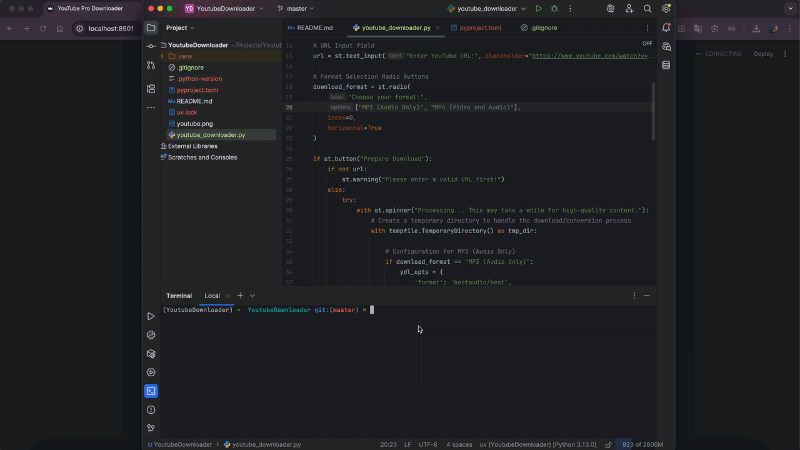

# YouTube Pro Downloader v2.0
A modern, fast, and cross-platform YouTube downloader built with **Python 3.13**, **Streamlit**, and **yt-dlp**. Download your favorite content as high-quality MP3 or QuickTime-compatible MP4 files.



## Evolution: From v1.0 to v2.0
This project has been completely modernized to overcome the limitations of the previous version.

- **Engine**: Switched from `pytube` to `yt-dlp` because `pytube` is no longer reliable against YouTube’s frequent API updates, whereas `yt-dlp` offers superior stability and speed.
- **Interface**: Replaced the `Tkinter` with `Streamlit`, providing a responsive, and web-ready user experience.
- **Infrastructure**: Updated to **Python 3.13** and implemented **uv** for faster, deterministic dependency management.

## v2.0 Features
- **MP3 Download:** High-quality 192kbps audio extraction.
- **MP4 Download:** H.264 video support.
- **Modern UI:** Clean and easy-to-use interface via Streamlit.
- **Cross-Platform:** Works seamlessly on macOS, Windows, and Linux.


## Getting Started

### 1. Prerequisites
First, ensure you have **FFmpeg** installed on your system (required for media processing):
- **macOS:** `brew install ffmpeg`
- **Windows:** Download from [ffmpeg.org](https://ffmpeg.org/download.html)
- **Linux:** `sudo apt install ffmpeg`

### 2. Setup with `uv` (Recommended)
This project uses **uv** for lightning-fast dependency management.
1. **Clone the repository**
   ```bash
   git clone https://github.com/ozgecinko/YoutubeDownloader.git
   cd YoutubeDownloader
   ```
2. **Install dependencies**
   ```bash
    uv sync
   ```
3. **Run the application**
   ```bash
    uv run streamlit run app.py
   ```

## License
This project is for educational purposes only. 
Please respect YouTube's Terms of Service.